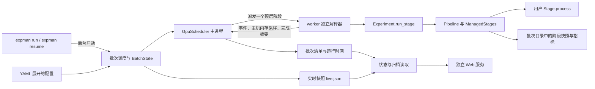

# expman 源码导读

expman 把一条 Python 实验流程应用到多份配置上，在一台 Linux 主机的 NVIDIA GPU 上调度这些实验，并保存足够的信息供中断后继续运行。用户编写每个阶段的计算逻辑。框架决定哪个阶段现在可以运行、运行在哪张卡上，以及 retry 或 resume 时应从哪里开始。安装、命令参数和可运行示例见 [README](README.md)。

## 目录与职责

| 源码目录 | 负责的工作 |
|---|---|
| [cli/](src/expman/cli/) | 解析命令，启动后台批次，在终端展示状态。 |
| [config/](src/expman/config/) | 加载实验 YAML，展开并校验每份配置。 |
| [core/](src/expman/core/) | 定义 Pipeline、Stage 和 Experiment，执行阶段并向用户代码提供运行上下文。 |
| [scheduling/](src/expman/scheduling/) | 管理批次生命周期，调度 worker，接收批次停止请求。 |
| [resources/](src/expman/resources/) 和 [estimation/](src/expman/estimation/) | 前者读取设备资源、管理 MPS 和资源限制，后者根据历史样本估计内存、显存和耗时。 |
| [storage/](src/expman/storage/) | 读写批次清单、阶段快照、共享缓存和指标。 |
| [observation/](src/expman/observation/) 和 [webui/](src/expman/webui/) | 前者整理实时状态、历史记录和实验结果，后者通过 HTTP 和网页展示这些数据。 |

## 从一次实验读起

假设实验包含“准备数据 → 训练”两个阶段，配置文件列出两种学习率。这个例子里有一个 **Batch**（整批实验）、两个 **run**（各自对应一个 `Experiment`、一份具体配置和一个稳定的 `run_id`）。两个 run 都要完成训练。**调度单元是某个 run 的一个顶层 Stage**，worker 只负责该阶段的一次尝试。若准备数据声明只依赖数据配置，两份配置在同一种子下可以共享准备好的数据。

1. **创建批次。** `expman run` 按 `module:attr` 导入 Pipeline，省略模块名时从 `pipeline_module` 指定的模块读取属性，默认为 `src.pipeline`。命令展开并合并输入 YAML 的配置。全部配置通过设备和种子校验后，创建一个批次，为每份不同的配置创建一个 run 目录，把解析后的 `module:attr` 和初始队列写入批次清单。[CLI](src/expman/cli/commands.py) · [批次调度](src/expman/scheduling/batch.py)
2. **选择任务。** 主进程取每个 run 当前就绪的顶层阶段。可以共享前缀的成员按组处理。命中缓存时，主进程只读元数据，把指标和共享节点引用写到目标 run，推进它的阶段位置。需要计算时，主进程从各阶段的就绪队列选取候选，再按主机内存和各卡显存余量决定派发哪些任务及其设备。启动 worker 前先持久化该成员的活动状态。[调度循环](src/expman/scheduling/scheduler.py) · [阶段分组](src/expman/scheduling/_stages.py)
3. **计算一个阶段。** worker 在独立解释器内核验 MPS 客户端，加载用户模块并重建 Experiment。执行第 `i` 个顶层阶段时，第一阶段从初始随机状态和输入 `None` 开始，其余阶段只需从第 `i - 1` 个阶段的快照取得输入和随机状态。目标阶段已有有效 checkpoint 时，从该保存点继续。[worker 入口](src/expman/scheduling/_worker.py) · [Experiment](src/expman/core/experiment.py) · [托管阶段执行](src/expman/core/execution.py)
4. **收集结果。** worker 通过本地 socket 把完成摘要传给后台调度器。调度器记录历史，释放占用，安排下一阶段或重试。成功的叶子留下完成记录，业务指标保存在 SQLite。`expman status ID` 从批次记录中读取各 run 的状态。[进程间通信](src/expman/scheduling/ipc.py) · [结果对象](src/expman/core/experiment.py)

## 定义一条流程

`Stage` 是用户扩展点。Pipeline 接收 **Stage 类**的序列，每个实际执行的位置都无参构造一个新实例，上一步的输出作为下一步的输入。构造非空 `Pipeline` 时，基类检查最后一个 Stage 的 `process()` 定义。该方法须为同步普通方法，只允许自然结束、`return` 和 `return None`。独立和嵌套的流程都遵循这一规则。在批次内，第一步收到 `None`，中间阶段的返回值须能通过 pickle 保存在快照中。Stage 的泛型描述单个阶段的输入输出，相邻阶段的类型兼容由流程作者负责。[Stage](src/expman/core/stage.py) · [Pipeline](src/expman/core/pipeline.py)

有两种常用的执行方式。调试单个转换时可调用 `stage.run(data)` 或 `pipeline.run(data)`，在调用者进程内同步执行。交给 Batch 托管时，同一个 `process` 会收到带存储服务的 `RunContext`。用户因此可以在循环内写 checkpoint、记录持久化指标。两种路径共用阶段的开始、结束、异常和父子事件语义。[运行上下文](src/expman/core/context.py) · [执行作用域](src/expman/core/execution.py)

| 在 `process` 中需要什么 | 对应的接口与契约 |
|---|---|
| 本次参数 | `ctx.cfg` 是当前 run 的只读配置。Stage 可以用 `config_dependencies(cfg)` 声明哪些配置路径会影响结果，默认依赖整份配置。 |
| 继续循环 | 将**下一次要执行的位置**和业务状态传给 `ctx.checkpoint(position, state)`。重试时 `ctx.checkpoint_state` 返回保存值，`ctx.resume_range(start, stop)` 从 `max(start, position)` 接续。 |
| 临时进度和事件 | `report_progress`、`report_metric` 送给 Recorder。普通 Recorder 错误被记录并隔离。各次调用有独立的执行 ID，事件可按父 ID 还原调用层次。 |
| 持久化的实验指标 | `ctx.log_metrics(mapping, step=...)` 将整批有限实数指标写入 SQLite。持久化失败会使当前阶段失败。 |
| 嵌套子流程 | `Pipeline([Child]).run(data, ctx)` 为子阶段分配独立存储位置。直接调用 `Child().run(data, ctx)` 只建立观测作用域。在该子调用中使用 `ctx.checkpoint()` 会抛出 `RuntimeError`，外层的 checkpoint 仍属于外层阶段。 |

## 框架设置与实验配置

CLI 以当前工作目录作为实验项目根目录。如果该目录有 `pyproject.toml`，CLI 在解析命令行参数前应用其中的 `[tool.expman]` 设置。CLI、调度器、资源采样和看板共用一处设置定义，显式命令行参数可以覆盖对应选项。流程模块在导入时可调用 `expman.set(...)` 覆盖当前进程的值。主进程启动独立 worker 时传入生效的设置。恢复时，重试次数和耗时区间覆盖率取自原批次清单，资源与调度参数采用本次会话的设置。[全局设置](src/expman/settings.py) · [命令入口](src/expman/cli/commands.py) · [worker 入口](src/expman/scheduling/_worker.py)

`expman run` 按命令行中配置名首次出现的顺序，从 `./configs/experiments/<配置名>.yaml` 逐个读取文件并独立展开。各文件共用本批次的默认文件缓存，展开结果按文件顺序合并。[配置加载](src/expman/config/loader.py) · [变体展开](src/expman/config/variants.py) · [批次约束](src/expman/config/schema.py)

- 展开按 `combines → grid → scan` 嵌套。`combines` 的每项是对基础参数的一份覆盖。`grid` 做各轴的笛卡尔积。`scan` 先取各轴首值组成基准点，再逐轴改变单个参数。默认值解析后，整批按完整配置去重，首次出现的位置决定各 run 在清单中的顺序。
- 映射节点可以写 `defaults: name`。加载器从当前工作目录读取 `./configs/<字段路径>/<name>.yaml`。字典递归合并，显式值优先，数组和 `null` 整体替换。默认文件缺失时，每个批次对同一路径只提示一次。
- 每份配置要求根部的 `seed`。同批次各配置的 `device` 列表必须具有相同的编号和顺序。`seed` 是无符号 32 位整数。依赖声明中的 `True` 表示整个子树，映射可细化到字段或序列下标。若训练读取学习率而准备数据只读取数据集，应由两个 Stage 分别声明。漏掉真正使用的配置项可能让缓存复用错误结果。[配置摘要](src/expman/core/dependencies.py)

## 哪些状态保存在哪里

下表的路径相对于批次目录。批次使用 pickle 保存快照和共享缓存，读取时应使用**可信本地记录**。`expman resume ID` 从批次清单中读取流程的导入位置，并用各 run 已保存的配置重建实验。每次写入批次清单都会生成新的修订标识。执行前，调度器取得批次锁并核对该标识，防止较早打开的会话覆盖后来保存的进度。

| 位置 | 内容和使用者 |
|---|---|
| `batch.pkl`、`timing.pkl` | 批次清单保存流程的导入位置和签名、重试次数和耗时区间覆盖率、队列、活动成员、阶段游标、尝试摘要和阶段历史。`timing.pkl` 单独记录批次累计墙钟时间和当前 ETA，估计区间未知时存为空值。 |
| `batch.log` | 启动成功后记录调度器在启动和运行期间的标准输出和错误输出。恢复批次时继续追加。 |
| `experiments/<run_id>/config.pkl`、`rng_initial.pkl` | 具体配置。worker 需要执行该 run 的阶段 0 时才创建或读取初始随机状态文件。 |
| `experiments/<run_id>/stages/<位置>/` | `status.pkl` 记录阶段状态，`checkpoint.pkl` 保存最近的中间进度，`completed.pkl` 记录阶段完成。共享中间结果通过引用定位，嵌套阶段的完成快照保存在本 run。每次 Pipeline 调用所在路径还有用于校验定义的 `pipeline.pkl`。 |
| `cache/<key>/<父节点>/<节点>/` | 中间节点的 `snapshot.pkl` 保存输出、业务状态和随机状态，`metadata.pkl` 保存供复用的依赖、指标和耗时。叶子只发布 `metadata.pkl`。 |
| `metrics.sqlite3` | 同批次各 run 的持久化标量。主键是 run ID、阶段路径、step、指标路径。重试重新写同一点时更新值，省略 step 的汇总值使用 `-1`。 |
| `experiments/<run_id>/attempts/stage-<i>/<尝试号>/` | worker 启动描述、输入和 `output.log`，可用来定位某次尝试的导入、启动或业务异常。 |
| `live.json` | 当前或最后一次发布的观测快照，供独立进程展示。运行队列的恢复依据是 `batch.pkl`。 |

[批次文件](src/expman/storage/batch.py) · [原子写和互斥锁](src/expman/storage/base.py) · [阶段文件](src/expman/storage/run.py) · [共享前缀](src/expman/storage/prefix_cache.py) · [指标库](src/expman/storage/metrics.py)

**恢复从三个粒度看。** `BatchState` 记录待调度的 run、已派发的 run 及每个 run 的下一阶段。恢复时先检查清单和 Pipeline 签名，将上次仍标为活动的 run 放回队首，并把中断的尝试记为取消。worker 从直接前驱的快照取得目标阶段的输入，中途失败的阶段从最后一个有效 checkpoint 继续。进程结束时仅保存在内存中的对象需要由用户的 `process` 重建。[批次状态](src/expman/scheduling/state.py) · [托管执行](src/expman/core/execution.py)

**阶段位置决定恢复哪条记录。** 一个顶层 Stage 的位置是它在 Pipeline 中的索引。嵌套 Pipeline 在父位置后加上调用序号和子阶段索引。checkpoint 同步保存调用计数、位置、业务状态、累计阶段耗时、配置依赖和随机状态。训练循环多次调用同一个验证 Pipeline 时，每轮都能找到对应的阶段快照。临时文件写入、刷新并同步成功后才原子替换目标。完成记录提交后清理该阶段的 checkpoint。损坏或依赖不匹配的 checkpoint 会告警并退回阶段入口。无法读取本 run 恢复所需的输出则报告存储错误。

**何时可以共享。** 在同一批次内，缓存以 Pipeline 签名和 seed 分区。签名由各 Stage 类的模块名、限定名和可读取的模块文件摘要组成。查找时还要匹配上一步的共享节点、当前阶段位置、完整的依赖路径集合及各路径的值摘要。这样，即使两个训练阶段配置相同，也只有上游数据来自同一前缀时才会共享。run 自己已经开始的阶段优先恢复自己的工作。中间节点先写快照，再发布元数据。命中时目标 run 保存完成记录并恢复相应指标。外部数据文件的内容变化需要由业务配置体现。

**何时回收。** 所有可能读取同一份输出的 run 都已成功完成直接后继阶段并保存进度时，调度器删除这个节点的快照和元数据。后继阶段还在排队、运行、重试或失败时，它需要的输入会保留。即使两份配置等价，重试也可能生成两份快照。run 一旦选定另一条实际缓存分支，就能从当前分支的使用者中排除。叶子只保存用于复用指标的元数据，最后一个可能复用它的 run 完成后即可删除。批次恢复时从已提交的进度继续回收。[缓存使用者与回收判定](src/expman/scheduling/_prefixes.py) · [节点存储](src/expman/storage/prefix_cache.py)

所有 run 成功且 worker 已退出后，批次还会清除写入过程中被中断、没有 run 引用的快照和空缓存子目录。各 run 的完成记录、耗时和 SQLite 指标独立保留。[批次收尾](src/expman/scheduling/batch.py) · [缓存清理](src/expman/observation/cleanup.py)

**随机状态与计时。** worker 执行阶段 0 时按 seed 初始化 Python、NumPy 和 PyTorch 全局随机生成器，或加载已保存的初始状态。CUDA 可用时也捕获各可见设备的状态。后续阶段从直接前驱的快照恢复随机状态。有 checkpoint 时，在调用 `process` 前重置到保存点。恢复会校验随机状态记录的格式、seed、CPU 状态与非空 CUDA 状态的设备数，应用失败时回滚。缺失或无效的随机状态会报错。用户自建的生成器和 DataLoader 子进程状态由用户保存。[随机状态实现](src/expman/core/randomness.py)

批次墙钟时间剔除停机间隔，按 `timing_save_interval` 定期保存。checkpoint 和阶段完成时保存的累计执行秒数都必须是有限的非负数。断点计时缺失或无效时会告警并从阶段开头重跑。已提交的阶段计时无效时读取报错。若在两个保存点之间失败，被丢弃的工作要重新执行。每次 worker 尝试的实测时长另计入调度历史和 run 的尝试摘要，因此排查重试开销应看尝试历史。[批次计时](src/expman/scheduling/batch.py) · [尝试收尾](src/expman/scheduling/scheduler.py)

## 调度器如何使用 GPU 和主机内存

单个 run 按阶段推进，多个 run 可以并发，不同阶段尝试可落在不同卡上。一次尝试用 GPU UUID 绑定一张可见卡，业务代码可使用 `cuda:0`。worker 向调度器上报已核验的 MPS 客户端 PID 和自己的主机内存采样。批次调度器按 GPU UUID 将客户端分组，每轮对有活跃客户端的卡各执行一次 `nvidia-smi --query-compute-apps`，按 PID 读取同卡各 worker 的当前显存用量。缺少有效读数时，当前用量记为未知，历史峰值保留本次尝试已采到的最大值。阶段结束后，worker 保持 CUDA 上下文，直到调度器完成这张卡的最后一次阶段采样再退出。[MPS 客户端核验](src/expman/resources/mps.py) · [主机 cgroup](src/expman/resources/limits.py) · [进程显存采样](src/expman/resources/gpu_memory.py)

| 调度时的问题 | 对应源码 |
|---|---|
| 哪些就绪任务进入候选？ | `StageWork` 按截至当前阶段的配置依赖和 seed 分组，跳过已有 worker 在运行的组，其余每组至多选一个代表。同一阶段先取重试任务，再取首次尝试的任务，两者各自保持就绪队列顺序。每阶段最多选 `candidates_per_stage` 个候选，再按阶段编号轮流取一个送入装箱。[阶段工作量](src/expman/scheduling/_stages.py) |
| 现在还能放多少作业？ | 主进程读取 `/proc/meminfo` 和 NVIDIA 设备读数，扣除主机保留量及活跃 worker 尚未使用的预算。冷启动时采用配置中的主机和 GPU 初始峰值预算，默认均为 1 GiB。资源不足时暂缓派发，压力持续时按规则减载。[设备采样](src/expman/resources/devices.py) · [容量计算](src/expman/scheduling/_resource.py) |
| 哪些作业放在哪张卡？ | `pack_candidates` 按估计峰值为候选预留主机内存和显存，每放置一个候选还占用目标卡的一个 MPS 客户端名额。已派发的 worker 从启动到进程回收一直占用名额。`mps_clients_per_gpu` 为正整数时，同卡尚未回收的 worker 数还受该硬上限约束。每考虑一个候选，保留代价最低的若干可行方案。主机剩余预算除以本轮派发前的主机预算，每张卡的剩余显存预算除以该卡物理显存总量。将这些比例分别平方后相加，即为方案代价。worker 的主机内存和显存硬上限分别取对应预估峰值 × `capacity_factor`（默认 1.10），显存上限还受所选卡的物理容量限制。主机 cgroup 不能核验时可回退到进程用量采样，快照分别记录实际用量、预算和已核验的上限。[装箱逻辑](src/expman/scheduling/_planning.py) |
| worker 报了什么？下一步如何处理？ | Worker 封装进程、IPC 消息和资源读数。普通失败按该 Stage 的重试预算处理。CUDA OOM 或主机限额终止用作需求下界，下一次重新估价。调度退出时回收 worker 进程组。[Worker](src/expman/scheduling/_process.py) · [调度循环](src/expman/scheduling/scheduler.py) |

`mps_clients_per_gpu` 默认为 `0`，由批次按 GPU 学习本次运行可用的并发数。某个 worker 在 MPS 启动时收到 CUDA 808，调度器记录设备与拒绝原因，将任务放回队列，保留其业务重试次数。这次启动的耗时和内存用量均跳过阶段模型采样。

调度器以受限卡上本批次已确认注册的客户端数作为暂定上限。即使填写了正整数硬上限，驱动拒绝也可能把暂定上限降得更低。客户端退出后，调度器可以补回空出的名额。有实际候选需要派发时，调度器每次最多试探一个额外名额，并按确认注册后的实际并发数更新上限。暂定上限为零时，调度器等待 `mps_retry_interval` 后再试。各卡独立更新，当前批次运行结束后释放学习状态。

ETA 按剩余的**阶段组**估算。调度器用单调时钟测量每次尝试占用 worker 的时长，历史样本与运行中的计时口径相同。每个顶层 Stage 用同批次实际执行成功的样本估计对数耗时的中心，配置越近权重越大。直接复用结果的阶段跳过采样。留一预测误差用于估计区间，取消尝试的实测时间只参与下界校准。峰值模型使用邻近配置的经验分位数。[峰值模型](src/expman/estimation/memory_model.py)

更新整批 ETA 时，调度器用同阶段最新的样本重新估算每个运行中的任务。模型将预测中心作为中位数，用历史耗时模型的 80% 参考区间（第 10 和第 90 百分位的估计）在中位数两侧分别拟合对数逻辑斯蒂分布。如果只有一个成功样本，模型假设这两个分位数分别为该样本的一半和两倍。以“任务至今仍在运行”为条件，模型从同一分布选取批次覆盖率或查询指定覆盖率对应的剩余时间分位数，即使任务已超过原预测上界也能继续估算。排队阶段直接按所请求的覆盖率计算耗时区间。[耗时模型](src/expman/estimation/duration_model.py)

同阶段尚无成功样本时，运行中的顶层 Stage 可以根据自己的进度测速。取同一次尝试、同一次阶段执行内的两条进度记录，要求总量和单位相同、完成计数递增。用两条进度事件的时间戳之差除以完成量之差，按单位耗时推算剩余步数所需的时间。将这个值作为上报时刻的剩余时间中位数，在两次上报之间，根据距最近一次有效读数的时长更新条件区间。步数已经走完时，只能靠同阶段的历史样本估计收尾时间。这样从 checkpoint 恢复的绝对步数也能参与测速，嵌套阶段的进度则保留在各自的执行记录里。

当每个剩余阶段组都有耗时估计且有可用并行位置时，`estimate_parallel` 按阶段依赖，分别使用各组的耗时下界和上界排程，取两次排程的完工时间组成整批区间。任一组缺少估计或没有可用并行位置时，整批区间未知。全部完成时上下界都为零。[并行 ETA](src/expman/scheduling/parallel_estimation.py)

## 观测与查错入口

CLI 和 Web 看板共用所选批次父目录下的 `.batches.sqlite3`，默认位置是 `./batches/.batches.sqlite3`。每个父目录独立分配批次 ID，每次选择登记表中最小的空闲非负整数。手动移除批次目录后，登记表仍保留该 ID。`expman delete ID` 在清除批次文件后释放登记记录，运行中的批次受执行锁保护。[批次登记](src/expman/observation/registry.py)

`expman status` 定期枚举当前父目录中的批次。`expman status ID` 通过登记表定位该批次，重读其运行记录并刷新详情。两种视图按 `status_interval` 刷新，默认为两秒。按 Ctrl+C 退出查看。`resume` 和 `stop` 使用同一登记表定位批次。[命令入口](src/expman/cli/commands.py)

`expman status` 与归档页面从批次文件重建状态。实验主进程另有旁路线程，把在锁内读到的调度状态和阶段完成组数整理为实时快照并原子写入 `live.json`，写入失败不会中断实验。`expman web` 在独立进程内通过 HTTP 和 SSE 提供这些数据。读取端在批次停止管道可连接且快照足够新鲜时标为实时。历史快照早于最新批次清单或快照不可用时，从持久化记录重建。页面查询不会触发训练或资源调度。[归档读取](src/expman/observation/status.py) · [快照构建](src/expman/observation/snapshot.py) · [来源判定](src/expman/observation/archive.py) · [Web 服务](src/expman/webui/server.py)

“实验结果”和“自动绘图”共用最近访问的 16 个批次的缓存。每批可保留结果表和最近一次请求的绘图数据。`experiments/` 目录条目变化、指标库文件被创建、移除或替换，或同一只读连接的 `PRAGMA data_version` 显示有新提交时，服务端会在下次请求时重读数据。浏览器刷新时带上对应响应的 ETag，内容相同则返回 HTTP 304。[Web 服务](src/expman/webui/server.py)

结果表按 run ID 关联配置与 SQLite 指标，对每个 run、阶段和指标取最大 step 对应的值。展示数据变化时，服务端通过单变量对照重新计算依赖和列顺序。绘图接口 `GET /api/batch/<ID>/plot` 共用这套对照逻辑，通过阶段路径和指标路径标识一条指标，并返回它是否有显式 step。[结果读取](src/expman/observation/results.py) · [依赖判断](src/expman/observation/metric_relations.py) · [结果表排序](src/expman/webui/result_layout.py)

当 X 轴为 `step` 或有 step 历史的指标时，浏览器用重复的 `metric` 参数请求所有带 step 指标的历史，以便筛选 Y 轴。服务端在同一 SQLite 读事务中读取各指标的最新值和所请求的历史，补写较早的 step 也可以更新曲线。浏览器以 JavaScript Number 读取步数，超过 `2^53 − 1` 时可能将相邻步数视为相同。变量控制通过比较不同 run 在同一 X 处的 Y 值生成。指标作横轴时，单条轨迹或多条完全重合的轨迹保留观测顺序。需要汇总时，浏览器按 X 计算均值，在该指标的相关控制变量保留多个取值且观测值有差异时绘制误差棒。[选轴与刷新](src/expman/webui/static/plot-panel.js) · [聚合与绘图](src/expman/webui/static/plot.js)

`expman run` 和 `expman resume` 在独立会话中启动批次。后台调度器取得执行锁、打开 `stop.fifo` 并通过启动检查后，CLI 向终端打印批次 ID 和目录，返回成功。启动期间的错误由 CLI 报给调用者。`expman stop` 和看板的“停止实验”按钮共用同一条停止管道。请求写入后，内核向持有读端的后台调度器发送 SIGTERM，调度器收尾并保存进度。[后台启动](src/expman/cli/_background.py) · [进程控制](src/expman/scheduling/control.py)

| 你遇到的现象 | 建议先读的行为测试 |
|---|---|
| 输入输出、事件父子关系或停止位置异常 | [Pipeline 测试](tests/cases/cpu/test_pipeline.py) |
| retry 后跑错步、状态冲突或随机序列改变 | [断点与恢复测试](tests/cases/cpu/test_stage_loop.py) · [RNG 测试](tests/cases/cpu/test_randomness.py) |
| 配置数量或合并结果与预期不同 | [配置展开测试](tests/cases/cpu/test_config.py) |
| 想验证真实的 CLI → MPS → CUDA 计算，以及重试、主动停止与恢复 | [真卡批次测试](tests/cases/gpu/test_cuda_batch.py) |
